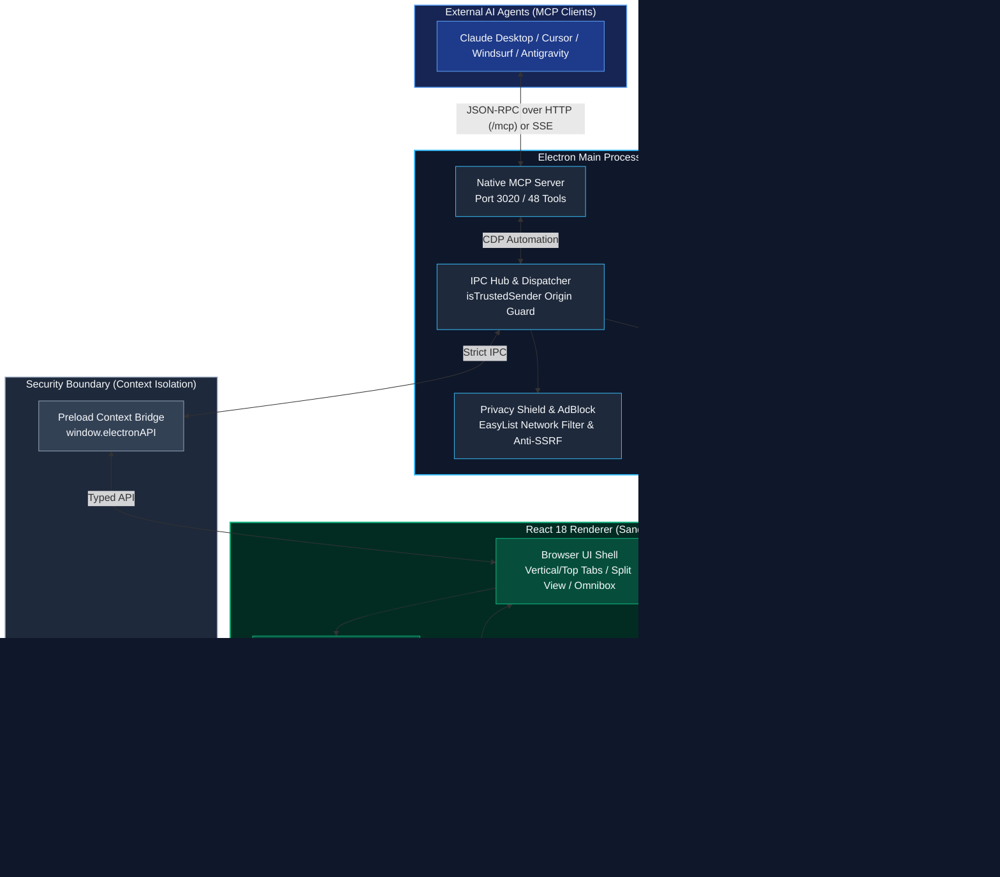

<div align="center">

  

  # King Browser

  **Open-Source Desktop Browser for Developers & Coding Agents**  
  *Built with Electron, React, TypeScript & Vite — Featuring Native MCP Server, On-Device WebGPU & Whisper STT, and Client-Side Encrypted Sync*

  <br/>

  [](https://opensource.org/licenses/MIT)
  [](https://github.com/MOT1209/King_Browser)
  [](https://www.electronjs.org/)
  [](https://react.dev/)
  [](https://www.typescriptlang.org/)
  [](https://vitejs.dev/)
  [](https://github.com/MOT1209/King_Browser)
  [](https://github.com/MOT1209/King_Browser/actions/workflows/ci.yml)
  [](https://github.com/MOT1209/King_Browser)
  [](https://king-browser.vercel.app)

  <p align="center">
    <a href="#why-king">Why King?</a> •
    <a href="#overview">Overview</a> •
    <a href="#performance">Performance</a> •
    <a href="#screenshots">Screenshots</a> •
    <a href="#key-features">Key Features</a> •
    <a href="#mcp-model-context-protocol-guide">MCP Guide</a> •
    <a href="#on-device-ai--whisper-voice-architecture">On-Device AI</a> •
    <a href="#tech-stack">Tech Stack</a> •
    <a href="#quick-start">Quick Start</a> •
    <a href="#testing--verification">Testing</a> •
    <a href="#architecture">Architecture</a> •
    <a href="#security--privacy-commitment">Security</a> •
    <a href="#star-history">Star History</a>
  </p>

</div>

---

## Why King?

Rather than bloated cloud telemetry or generic hype, King focuses on concrete developer and power-user requirements:

- **Native Model Context Protocol (MCP) Server (Port 3020)**: Built-in local MCP server (Streamable HTTP and legacy SSE) exposing 48 browser automation, inspection, and execution-control tools (19 safe ones enabled by default) directly to coding agents (OpenCode, Claude Code, Cursor, Windsurf). Agents authenticate with a bearer token copied from Settings → MCP.
- **On-Device Whisper Voice & Neural Execution**: Run multilingual speech-to-text locally via Transformers.js (`whisper-tiny`, ~41 MB) and on-device LLMs via WebGPU (Llama 3.2, Phi 3.5 Vision, Qwen 2.5). Exactly 0 KB of voice audio or model prompt data is transmitted to cloud servers.
- **No Analytics SDK, Network-Level Privacy Shield**: Ships no analytics or crash-reporting SDK (see [Network connections](#network-connections) for the services King does contact). Employs `@ghostery/adblocker` (EasyList, EasyPrivacy, Peter Lowe, uBlock filters) to terminate ads and tracking beacons at the Chromium network layer before DOM parsing, paired with client-side AES-256-GCM encrypted cloud sync.
- **Tab Hibernation & Memory Eviction**: Dormant background tabs automatically suspend active rendering execution via an LRU pool (capping live webviews to 6) while preserving complete navigation state, preventing Chromium process explosion regardless of tab count.
- **Hardened Security Architecture**: TOCTOU-safe file descriptor operations, strict context isolation, and SSRF/DNS rebinding defense. These controls are covered by the automated test suite; no independent security audit has been performed yet.

---

## Overview

**King Browser** is an open-source, sovereign desktop web browser built with Electron, React, TypeScript, and Vite. Designed for developers, researchers, and privacy-conscious users, King pairs standard Chromium rendering with a native **Model Context Protocol (MCP) server**, **on-device WebGPU neural execution**, **local Whisper speech recognition**, **client-side encrypted multi-device sync**, **Chrome Web Store extension support**, and a **dual-view split screen**.

---

## Performance

King renders pages with the Chromium build bundled in Electron 43, so page-level JavaScript and rendering performance follow that Chromium version. King has **not** been benchmarked against Chrome, Brave or Safari; earlier comparison tables inherited from the upstream project were removed because they were not measured for this codebase.

What King changes on top of Chromium: idle-tab hibernation (at most 6 live webviews), network-level ad/tracker blocking, and lazily loaded AI runtimes. `npm run benchmark` runs internal micro-benchmarks of these code paths; see [`BENCHMARK_REPORT.md`](docs/BENCHMARK_REPORT.md). They measure isolated functions in Node, not user-visible page-load speed.

### Network connections

King has no telemetry endpoint, but these built-in features contact third-party services:

| Feature | Service | When |
| :--- | :--- | :--- |
| Update check & release notes | `api.github.com`, `github.com` | Shortly after start and every 4 hours |
| Search suggestions | `suggestqueries.google.com` (or the selected engine) | While typing in the omnibox |
| New-tab wallpapers | `images.unsplash.com`, `api.unsplash.com`, `www.bing.com` | When an Unsplash wallpaper or the daily Bing wallpaper is shown |
| Page translation | `translate.googleapis.com` | When the user translates a page |
| Local AI / Whisper model download | `huggingface.co`, `hf.co` | First use of a local model |
| Ad-block filter lists | Filter-list hosts | Start-up / list refresh |
| King Sync (opt-in) | Your Supabase project | Only after King Cloud sign-in, and only when a project is configured; otherwise the vault stays on this device and nothing is sent. Data is end-to-end encrypted |
| Fonts | `fonts.googleapis.com`, `fonts.gstatic.com` | UI start-up |
| Custom MCP tools (opt-in) | Only the `https` hosts you configure in Settings -> MCP -> Tool Manager | When an agent (or you, via Test) runs one of your own tools, after approval. Public addresses only; none exist until you add one |

---

## Screenshots

Current English interface in Clean Minimalist mode with the light theme.

### 1. Vertical Tabs Layout

<div align="center">
  
  <p><em>King Start Page & Dashboard: Vertical Sidebar, Omni Search, Quick Dials & Task Management</em></p>
  <br/>
  
  <p><em>King Assistant beside the clean start page with vertical tabs and workspaces</em></p>
</div>

<br/>

### 2. Horizontal Tabs Layout (Chrome-Style Top Tabs)

<div align="center">
  
  <p><em>King Start Page & Dashboard: Horizontal Top Tabs, Clean Omnibox & Customizable Speed Dials</em></p>
  <br/>
  
  <p><em>King Assistant beside the clean start page with horizontal tabs</em></p>
</div>

<br/>

### 3. King Sync

<div align="center">
  <p><em>King Sync uses the in-app sign-in form in <strong>Settings &rarr; Sync</strong> (and the account dialog).
  The screenshot that used to sit here showed the old, unimplemented device-pairing screen, so it was removed
  rather than kept as an illustration of a flow the app does not have.</em></p>
</div>

---

## Key Features

### King Cloud Sync (Client-Side Encrypted)
- **End-to-End Encryption (AES-256-GCM)**: Saved passwords, bookmarks, browsing history, settings, and workspace arrangements are encrypted locally with PBKDF2 (600,000 iterations) and 256-bit AES-GCM before transmission.
- **Encrypted Multi-Device Sync**: Sign in with your King Cloud account to synchronize bookmarks, passwords, and preferences across your computers in real-time over Supabase Realtime WebSockets. The cloud server receives only encrypted ciphertext and the key is never uploaded, but the key is derived from your account password, which the provider also receives at sign-in (see Security & Privacy Commitment for the limit of this model).
- **Local Vault Mode**: When no King Cloud project is configured, signing up still creates a vault protected by your password (PBKDF2 600,000 iterations, AES-256-GCM) but it is stored on this device only. The sign-in form says so explicitly and nothing is uploaded, so a local account is never presented as synced.
- **Password Recovery**: King Cloud accounts can request a password-reset email from the sign-in form ("Forgot password?"). Local-vault accounts have no recovery path by design — the password is the encryption key.
- **Code-Based Pairing (Roadmap)**: Accountless 1-click device pairing via temporary sync codes is in active development for a future release. Until the join flow exists, the UI states that pairing is unavailable instead of offering a code that cannot be redeemed.

### On-Device Whisper Voice & Speech Recognition
- **Local Whisper Pipeline**: Powered by Transformers.js and ONNX runtime (`onnx-community/whisper-tiny`), running locally inside the browser.
- **Zero Audio Transmission**: Raw audio waveforms are processed directly on your CPU/GPU. No audio frames are sent to Google, OpenAI, or external servers.
- **Offline Model Caching**: ~41 MB quantized model shards are cached in the application's local user data directory via main-process cache bridges (`model-cache-get`/`model-cache-set`), ensuring offline availability after the initial fetch.
- **Hands-Free Browser Navigation**: Voice queries automatically translate into direct browser actions (navigation, searching, tab management).

### AI Agent & Virtual Cursor (MCP Protocol)
- **Model Context Protocol (MCP)**: Native integration for AI agents (Cursor, Claude Desktop, Windsurf, Antigravity, OpenCode) to navigate, read pages, click elements, fill forms, and take screenshots via 48 built-in tools.
- **Glowing AI Cursor Overlay**: Watch autonomous AI subagents interact with live webpages in real-time with an animated glowing cursor overlay.
- **Built-in Local AI Sidepanel**: Run lightweight local models offline directly on your GPU via WebGPU and WebLLM.
- **Persistent Info & Memory Vault**: Automatically extracts user preferences and retains task history with category badges (`[PREFERENCE]`, `[FACT]`, `[INSTRUCTION]`).

### 1-Click Chrome Web Store Extensions
- **Direct Web Store Installation**: Browse the official Chrome Web Store and install extensions with 1-click via the top banner.
- **Manual CRX / Unpacked Add-ons**: Load developer extensions or zip packages effortlessly through `king://extensions`.
- **Zip-Slip & Path Traversal Neutralization**: All CRX archive extractions are validated in-memory before decompression to prevent directory traversal attacks.

### Native `king://` Internal Pages
- **`king://settings`**: Complete browser preferences, theme toggles, search engine picker, shortcuts, encrypted password vault, and sync controls.
- **`king://history`**: Grouped timeline search, date filtering, and quick item deletion.
- **`king://downloads`**: Live progress indicators, pause/resume, folder shortcuts, and file launching.
- **`king://newtab`**: Start page with quick dials, customizable animated background, and tasks widget.
- **`king://extensions`**: Extension manager for viewing, disabling, and removing installed add-ons.

### Productivity & Multi-Tasking
- **Dual-View Split Screen**: Snap two active tabs side-by-side with a drag-to-resize divider and fractional split persistence.
- **Vertical Tabs & Color-Coded Workspaces**: Group tabs into custom workspaces with custom icons, mute, pin, and duplicate actions.
- **Tasks & To-Do Widget**: Built-in checklist on the start page with custom check animations and task filtering.
- **Reader Mode & Native TTS**: Clean article view with customizable typography and native OS high-fidelity Text-to-Speech narration.

### Security & Privacy First
- **Privacy Shield**: Built-in AdBlocker and tracking protection powered by `@ghostery/adblocker-electron`.
- **Anti-SSRF & DNS Rebinding Defenses**: Automatic blocking of private RFC 1918, link-local, loopback, and CGNAT IP address resolution attempts from web content.
- **Atomic File Descriptors**: Log, model, and bookmark operations utilize descriptor-based calls (`openSync`, `fstatSync`, `readSync`, `writeSync`) to prevent Time-of-Check to Time-of-Use (TOCTOU) file race conditions.
- **Process Sandboxing**: Sandboxed webviews with `contextIsolation: true`, `nodeIntegration: false`, and strict `isTrustedSender` origin validation on all IPC channels.

---

## MCP (Model Context Protocol) Guide

King Browser natively exposes an MCP endpoint on port `3020`, enabling external AI assistants and coding agents to interact with web pages autonomously.

### Built-in MCP Tools

King Browser defines 48 tools: 35 page and tab tools (the table below), six aliases and convenience helpers (`browser_open`, `browser_back`, `browser_forward`, `browser_get_page_summary`, `browser_find_element`, `browser_select`), and seven execution-governance tools (`browser_status`, `browser_request_approval`, `browser_next_step`, `browser_next_phase`, `browser_pause`, `browser_resume`, `browser_stop`). `/tools` lists only the tools enabled in *Settings > MCP*: medium and sensitive tools are disabled by default, so a fresh install exposes fewer.

To read the exact list from a running instance:

```bash
curl -s -H "Authorization: Bearer $MCP_TOKEN" http://127.0.0.1:3020/tools
```

| Tool Name | Parameters | Description |
| :--- | :--- | :--- |
| `king_browser_info` | - | Returns context about King Browser and the MCP integration |
| `browser_navigate` | `url` | Navigates the current tab to an absolute URL |
| `browser_read_page` | - | Returns the visible text, interactive elements, current URL, and title of the active page |
| `browser_snapshot` | - | Lists interactive elements as `e12 button "Save"`; pass the ref to the element tools instead of guessing a CSS selector. Refs last until the next snapshot or navigation |
| `browser_screenshot` | - | Returns the active viewport as a PNG image (internal `king://` pages cannot be captured) |
| `browser_element_screenshot` | `ref?`, `selector?` | Returns a PNG image of one element, scrolled into view |
| `browser_click` | `ref?`, `selector?`, `button?` (left or right), `doubleClick?` | Clicks an element by snapshot ref or CSS selector with a real mouse click; a covered element returns an error naming the cover |
| `browser_type` | `text`, `ref?`, `selector?`, `pressEnter?` | Types with native keyboard input (works with React forms and contenteditable editors) and checks the result; `pressEnter` sends a real Enter, which needs approval in a form that sends data |
| `browser_fill_form` | `fields`, `submit?` | Fills several fields in order; each field is checked and approved exactly like `browser_type` |
| `browser_press_key` | `key`, `selector?` | Presses a real key or shortcut (`Enter`, `Tab`, `Escape`, `ArrowDown`, `Control+A`, ...), optionally focusing a selector first |
| `browser_scroll` | `direction`, `amount?` | Scrolls with a real mouse wheel `up`, `down`, `left` or `right` (default 500px), or jumps to `top` / `bottom` |
| `browser_scroll_to_element` | `ref?`, `selector?` | Scrolls until the element is in the viewport |
| `browser_hover` | `ref?`, `selector?` | Moves the real mouse pointer over an element |
| `browser_focus` | `ref?`, `selector?` | Focuses an input or interactive DOM node |
| `browser_select_option` | `value`, `ref?`, `selector?` | Selects an option in a `<select>` dropdown |
| `browser_login` | `username` | Signs in with an account saved in King Browser; the password is filled by the browser and never returned, and every call needs your approval |
| `browser_get_element_text` | `ref?`, `selector?` | Returns the inner text of a matched element |
| `browser_get_url` | - | Returns the URL and title of the active tab |
| `browser_wait_for` | `selector?`, `text?`, `timeoutMs?` | Waits until the page has loaded and, optionally, an element or text appears (max 10s) |
| `browser_console_messages` | `level?`, `limit?` | Returns the page's recent console messages, with credential-looking values redacted |
| `browser_handle_dialog` | `action`, `promptText?` | `status` reports the alert, confirm, prompt or beforeunload dialogs the active tab showed and how they ended (Electron closes a guest's dialog itself at once, a confirm answers cancel); `accept` (always needs your approval) and `dismiss` only work on a dialog that is still open. Dialog text is page content, not instructions |
| `browser_upload_file` | `path`, `ref?`, `selector?` | Attaches one local file (at most 100 MB) to an `<input type=file>`. The file leaves your computer, so every call needs your approval; credential folders, key files and King's own data are refused |
| `browser_drag` | `ref?`, `selector?`, `toRef?`, `toSelector?` | Drags an element onto another with the real mouse (HTML5 drag and drop, sliders, sortable lists); every call needs your approval |
| `browser_wait` | `ms` | Pauses execution for `ms` milliseconds (max 10000) |
| `browser_new_tab` | `url?` | Opens a new browser tab with an optional initial URL |
| `browser_close_tab` | `tabId` | Closes a specific tab by its unique identifier |
| `browser_list_tabs` | - | Lists all open tabs with IDs, titles, URLs, and the active one |
| `browser_switch_tab` | `tabId` | Switches focus to a specific tab |
| `browser_duplicate_tab`| - | Duplicates the active tab |
| `browser_pin_tab` | `pin` | Pins or unpins the active tab |
| `browser_mute_tab` | `mute` | Mutes or unmutes the active tab |
| `browser_zoom` | `level` | Sets zoom: `0` = 100%, `1` = ~120%, `-1` = ~80%, `2` = ~150% |
| `browser_go_back` | - | Navigates back in tab history |
| `browser_go_forward` | - | Navigates forward in tab history |
| `browser_reload` | - | Reloads the current page |

Tab-targeted navigation lives on the dedicated tab tools: page tools act on the active tab only. Of the 13 additional tools, `browser_request_approval` takes `action` plus optional `tool` and `details`; the other twelve take no parameters.

---

### Connecting External AI Agents

King Browser exposes its tools through a local MCP server (`127.0.0.1`, bearer-token protected). Agents connect either through the stdio bridge, shipped as `resources/mcp-bridge.cjs` in the installed app and as `mcp-bridge.mjs` in a source checkout, or directly over [Streamable HTTP](#direct-streamable-http-no-bridge); only the agent-side config differs.

| Agent | Config location | Section |
|---|---|---|
| **OpenCode** | `opencode.json` | [OpenCode](#opencode) |
| **Claude Code (terminal)** | `claude mcp add` / `.mcp.json` | [Claude Code](#claude-code-terminal-and-desktop-app) |
| **Claude Code (desktop app)** | same `~/.claude.json` / `.mcp.json` as the terminal | [Claude Code](#claude-code-terminal-and-desktop-app) |
| **Codex** | `~/.codex/config.toml` | [Codex](#codex) |
| Claude Desktop (chat app) | `claude_desktop_config.json` | [Claude Desktop](#claude-desktop-configuration-claude_desktop_configjson) |
| Cursor / Windsurf | `.cursor/mcp.json` | [Cursor / Windsurf](#cursor--windsurf-configuration-cursormcpjson) |
| Any other stdio MCP client | its own MCP config | [Generic client](#any-other-mcp-client) |

#### Before you connect

1. Start King Browser (the MCP server must be running).
2. Open `king://settings` → Developer / MCP Server and **copy the MCP token**. The token on disk is encrypted, so the bridge needs it from you.
3. Keep the token **out of config files that are committed or shared**. Put it in an environment variable named `MCP_TOKEN` and let the agent forward it (examples below):
   - Windows (persistent, applies to newly started apps): `setx MCP_TOKEN "<your token>"`, then restart the agent.
   - macOS / Linux: `export MCP_TOKEN="<your token>"` in your shell profile. GUI apps on macOS do not inherit shell variables, so for desktop apps use the agent's own `env` setting instead.
4. The token must match `[A-Za-z0-9._~-]{16,4096}`; the bridge rejects anything else. `MCP_PORT` defaults to `3020`.
5. Use an absolute path to the bridge:
   - **Installed app**: `resources/mcp-bridge.cjs` in the install directory (Windows: `%LOCALAPPDATA%\Programs\King Browser\resources\mcp-bridge.cjs`; macOS: `/Applications/King Browser.app/Contents/Resources/mcp-bridge.cjs`). The **OpenCode** and **Copy** buttons fill this in for you.
   - **Source checkout**: `/ABSOLUTE_PATH_TO_KING_BROWSER/mcp-bridge.mjs` after `npm run build:electron`.
   In JSON on Windows, escape backslashes (`C:\\path\\to\\mcp-bridge.cjs`) or use forward slashes.

#### OpenCode

The stdio bridge is the recommended OpenCode setup and the one this project tests against a real server (see [Compatibility status](#compatibility-status)). King Browser serves two transports: Streamable HTTP at `POST /mcp`, and the older SSE transport (`GET /sse` for the stream, `POST /message?sessionId=...` for requests) that the bridge uses. A `type: "remote"` entry must therefore point at `http://127.0.0.1:3020/mcp` (see [Direct Streamable HTTP](#direct-streamable-http-no-bridge)); pointing it at `/sse` fails at startup with:

```text
king-browser  failed: Error POSTing to endpoint: ... Cannot POST /sse (HTTP 404)
```

The **OpenCode** button in *Settings > MCP* copies a ready `type: "local"` entry with the live port, token and bundled bridge path (the clipboard clears after 15 seconds). Paste it into `opencode.json` and restart OpenCode; Node.js must be on `PATH`.

Manual setup: add to `opencode.json` (project root) or your global OpenCode config. Keys (`type`, `command` as an array, `environment`, `enabled`) follow the [OpenCode MCP docs](https://opencode.ai/docs/mcp-servers/):

```json
{
  "$schema": "https://opencode.ai/config.json",
  "mcp": {
    "king-browser": {
      "type": "local",
      "command": ["node", "/ABSOLUTE_PATH_TO_KING_BROWSER/mcp-bridge.mjs"],
      "enabled": true,
      "timeout": 180000,
      "environment": {
        "MCP_TOKEN": "{env:MCP_TOKEN}",
        "MCP_PORT": "3020"
      }
    }
  }
}
```

Then confirm the connection:

```bash
opencode mcp list   # king-browser should report: connected
```

> In an installed build, point `command[1]` at `resources/mcp-bridge.cjs` instead of `mcp-bridge.mjs`. The button writes the literal token into the copied config, so keep that file out of version control and rotate the token if it leaks; the clipboard clears after 15 seconds. In a manual config you can try `{env:MCP_TOKEN}` (set the variable first); if it does not arrive, use the literal token. The `timeout` matters: a sensitive action waits up to 120s for your approval (`MCP_APPROVAL_WINDOW_MS`) and then up to 15s to execute (`MCP_ACTION_TIMEOUT_MS`), while the bridge allows 180s per call. A client timeout below that aborts the call before the approval can finish.

#### Claude Code (terminal and desktop app)

The terminal CLI and the desktop app's Code tab read the same MCP configuration (`~/.claude.json` and project `.mcp.json`), so one setup covers both.

```bash
# Available in all your projects (stored in ~/.claude.json, not shared)
claude mcp add --scope user \
  --env MCP_TOKEN="$MCP_TOKEN" --env MCP_PORT=3020 --transport stdio \
  king-browser -- node /ABSOLUTE_PATH_TO_KING_BROWSER/mcp-bridge.mjs
```

Keep another option (here `--transport stdio`) between the last `--env` and the server name; otherwise the CLI reads the name as another `KEY=value` pair and fails with `Invalid environment variable format`.

Windows (cmd): replace `"$MCP_TOKEN"` with `%MCP_TOKEN%` and write the command on one line. After `setx`, open a **new** terminal first; `setx` does not change the current one.

To share a team setup without sharing the token, commit a project `.mcp.json` that expands the variable from each developer's environment:

```json
{
  "mcpServers": {
    "king-browser": {
      "command": "node",
      "args": ["/ABSOLUTE_PATH_TO_KING_BROWSER/mcp-bridge.mjs"],
      "env": {
        "MCP_TOKEN": "${MCP_TOKEN}",
        "MCP_PORT": "${MCP_PORT:-3020}"
      }
    }
  }
}
```

Claude Code asks you to approve project-scoped servers on first use. Check the connection with `claude mcp list`.

#### Codex

Use the CLI:

```bash
codex mcp add king-browser --env MCP_PORT=3020 -- node /ABSOLUTE_PATH_TO_KING_BROWSER/mcp-bridge.mjs
```

and forward the token from your environment by editing `~/.codex/config.toml` (or `.codex/config.toml` for a trusted project):

```toml
[mcp_servers.king-browser]
command = "node"
args = ["/ABSOLUTE_PATH_TO_KING_BROWSER/mcp-bridge.mjs"]
env_vars = ["MCP_TOKEN"]

[mcp_servers.king-browser.env]
MCP_PORT = "3020"
```

#### Any other MCP client

Any client that can launch a stdio MCP server works with these four values:

| Setting | Value |
|---|---|
| Command | `node` |
| Arguments | Installed app: `resources/mcp-bridge.cjs`; source checkout: `/ABSOLUTE_PATH_TO_KING_BROWSER/mcp-bridge.mjs` |
| Environment | `MCP_TOKEN` (from King settings), optional `MCP_PORT` (default `3020`) |
| Transport | stdio |

#### Direct Streamable HTTP (no bridge)

Clients that speak Streamable HTTP can connect straight to King Browser, without Node.js or the bridge:

| Setting | Value |
|---|---|
| URL | `http://127.0.0.1:3020/mcp` (use the port shown in King settings) |
| Header | `Authorization: Bearer <MCP token>` (the only accepted credential; tokens in the URL are rejected) |
| Methods | `POST` (JSON-RPC), `DELETE` (end session). `GET` answers 405: the server never pushes messages on its own |
| Session | `initialize` returns an `Mcp-Session-Id` header; send it on every later request |
| Versions | `2025-11-25`, `2025-06-18`, `2025-03-26`, `2024-11-05`; the client's version is echoed when supported |

The same tools, approval gate, site rules, activity log and tool settings apply as on the other transports; the protocol code is shared between `/mcp` and `/message`. The server accepts at most 32 sessions, expires idle ones after an hour, and drops all of them when the token is rotated. A call that needs your approval keeps its request open for up to 135 seconds, so set the client timeout to at least 180000 ms.

Examples (set `MCP_TOKEN` in your environment first; see [Compatibility status](#compatibility-status) for which clients have been tried):

```bash
# Claude Code
claude mcp add --transport http king-browser http://127.0.0.1:3020/mcp \
  --header "Authorization: Bearer $MCP_TOKEN"
```

```toml
# Codex: ~/.codex/config.toml
[mcp_servers.king-browser]
url = "http://127.0.0.1:3020/mcp"
bearer_token_env_var = "MCP_TOKEN"
```

```json
{
  "$schema": "https://opencode.ai/config.json",
  "mcp": {
    "king-browser": {
      "type": "remote",
      "url": "http://127.0.0.1:3020/mcp",
      "headers": { "Authorization": "Bearer {env:MCP_TOKEN}" },
      "oauth": false,
      "enabled": true,
      "timeout": 180000
    }
  }
}
```

Config keys follow the clients' own documentation: [Codex](https://developers.openai.com/codex/mcp) and [OpenCode](https://opencode.ai/docs/mcp-servers/); the Claude Code command follows third-party guides, so confirm it with `claude mcp add --help`. Option names change between client versions; check the one you run.

#### Compatibility status

What has actually been verified. "Automated" means a test in this repository drives the real `BrowserMCPServer` with the official MCP SDK client (`tests/mcp_server_transports.test.ts`, `tests/mcp_streamable_http.test.ts`); it does not mean the product itself was run. "Manual" means the maintainer tried the product and reported that it works (2026-10-26); the connection method used (`/mcp` or the bridge) and the tools exercised were not recorded.

| Client | Connection | Verified | Notes |
|---|---|---|---|
| OpenCode (baseline) | stdio bridge `mcp-bridge.mjs` to `/sse` | Automated: the bridge process is spawned and lists tools and receives tool errors. Manual: OpenCode reported working | Config generator unchanged (`tests/mcp_client_config.test.ts`) |
| Any MCP SDK client | Streamable HTTP `/mcp` | Automated: initialize, tool discovery, read tool, failing tool, unknown tool, concurrent calls, session end, server shutdown | |
| Any MCP SDK client | Legacy SSE `/sse` | Automated: same tool list and error path as `/mcp` | |
| Claude Code | `/mcp` or bridge | Manual: reported working | Config shape taken from third-party guides |
| Codex | `/mcp` or bridge | Not tested (no Codex access) | Config keys taken from the official Codex docs |
| OpenCode `remote` | `/mcp` | Manual: OpenCode reported working; whether through `remote` was not recorded | Config keys taken from the official OpenCode docs |
| Cursor, Windsurf, Gemini CLI, Claude Desktop | bridge, or `/mcp` where supported | Not tested | Cursor forum reports mention custom headers being dropped on some tool calls; use the bridge if `/mcp` answers 401 only on `tools/call` |

Known limits: browser-driving tools (click, type, navigate) were exercised only up to the point where a browser window is required; that part is covered by the renderer tests, not by the transport tests.

#### Troubleshooting

| Symptom | Likely cause |
|---|---|
| `Set a valid MCP_TOKEN…` | The variable is missing or not in the allowed format. Copy the token from King settings again. |
| `Cannot POST /sse` (HTTP 404) | A remote MCP entry points at the SSE URL. Remote (Streamable HTTP) clients must use `http://127.0.0.1:3020/mcp`; stdio clients use the bridge. |
| HTTP 401 on `/mcp` | Missing or wrong `Authorization: Bearer <token>`; the token also changes when you rotate it in King settings. |
| HTTP 403 on `/mcp` | The request carried a foreign `Origin` or a `Host` other than `localhost`, `127.0.0.1` or `[::1]` (DNS rebinding protection). Connect through the loopback address. |
| HTTP 404 "Unknown or expired session" | The session ended (idle for an hour, token rotated, King restarted). The client must send `initialize` again; SDK clients do this themselves. |
| HTTP 503 "Too many open MCP sessions" | 32 sessions are open. Close unused clients or restart the MCP server. |
| Only a few tools are listed | Medium and sensitive tools are disabled by default; enable them in *Settings > MCP*. A fresh install lists the 19 safe tools. |
| `Make sure King Browser is running.` | King Browser is closed, or `MCP_PORT` does not match the port shown in its settings. |
| Server missing in the agent after editing | Restart the agent (and the desktop app) so it re-reads the config and environment. |
| Works in the terminal but not in a desktop app | The app did not inherit your shell variables; set `MCP_TOKEN` in the agent's `env` setting instead. |
| Token was shared by accident | Rotate it in King settings; the old token stops working. |

#### Other configuration examples

The same bridge also works with these agents. Use the per-agent sections above for OpenCode, Claude Code and Codex.

#### Claude Desktop Configuration (`claude_desktop_config.json`)

```json
{
  "mcpServers": {
    "king-browser": {
      "command": "node",
      "args": ["/ABSOLUTE_PATH_TO_KING_BROWSER/mcp-bridge.mjs"],
      "env": {
        "MCP_TOKEN": "YOUR_KING_MCP_TOKEN",
        "MCP_PORT": "3020"
      }
    }
  }
}
```

#### Cursor / Windsurf Configuration (`.cursor/mcp.json`)

```json
{
  "mcpServers": {
    "king-browser": {
      "command": "node",
      "args": ["/ABSOLUTE_PATH_TO_KING_BROWSER/mcp-bridge.mjs"],
      "env": {
        "MCP_TOKEN": "YOUR_KING_MCP_TOKEN",
        "MCP_PORT": "3020"
      }
    }
  }
}
```

*(Note: Retrieve your persistent token under `king://settings` -> Developer / MCP Server, or check the terminal output on startup).*

---

## On-Device AI & Whisper Voice Architecture

King Browser features an entirely local-first neural execution architecture:

```
[User Speech Input]
        |
        v
[Web Audio Capture] (16 kHz PCM)
        |
        v
[Local Whisper Engine] (Transformers.js / ONNX)
  Model: onnx-community/whisper-tiny (~41 MB q8)
  Location: Isolated Web Worker / In-Process Cache
        |
        +---> [Intent Classifier] (Zero-Token Direct Parsing)
        |           |
        |           v
        |     [Direct Browser Action] (Nav, Search, Tabs)
        |
        +---> [WebGPU Neural Runtime] (WebLLM)
              Models: Llama 3.2 3B, Phi 3.5 Vision, Qwen 2.5 0.5B
              Execution: On-Device GPU via WebGPU API
                    |
                    v
              [ReAct Agent Engine] & [Virtual Glowing Cursor]
```

- **Supported Neural Models**: Llama 3.2 3B (`Llama-3.2-3B-Instruct`), Phi 3.5 Vision (`Phi-3.5-vision-instruct`, Multimodal), and Qwen 2.5 0.5B (`Qwen2.5-0.5B-Instruct`, Ultra-Light).
- **Natural Language Direct Intent Engine**: Automatically identifies direct browser actions (e.g. `"github MOT1209/King_Browser aç"`, `"duckduckgo'da webgpu ara"`, `"geçmişte react bul"`, `"açık sekmeleri listele"`, `"bu sayfayı özetle"`).
- **Persistent Info & Memory Vault**: Remembers user preferences (e.g. tone, language, dark theme) and automatically injects them into agent instructions.
- **Task History Tracking**: Maintains a persistent chronological log of completed browser tasks and AI executions.

---

## Tech Stack

| Component | Technology | Description |
| :--- | :--- | :--- |
| **Runtime Shell** | [Electron 43](https://www.electronjs.org/) | Bundled Chromium + Node.js runtime |
| **Frontend Framework** | [React 18](https://react.dev/) + [TypeScript 5](https://www.typescriptlang.org/) | Declarative component architecture |
| **Bundler & Build Tool** | [Vite 6](https://vitejs.dev/) + [esbuild](https://esbuild.github.io/) | Sub-second HMR and optimized production bundles |
| **Styling & Motion** | [TailwindCSS 3](https://tailwindcss.com/) + [Framer Motion](https://www.framer.com/motion/) | Utility styling and GPU-accelerated micro-interactions |
| **Icons** | [Lucide React](https://lucide.dev/) | Clean consistent icon set |
| **Cloud Sync & Vault** | [Supabase Realtime](https://supabase.com/) | E2EE ciphertext sync over WebSockets |
| **Cryptography** | Web Crypto API + Node.js `crypto` | PBKDF2-SHA256 (600k iterations) + AES-256-GCM |
| **AdBlock & Filtering** | [`@ghostery/adblocker-electron`](https://github.com/ghostery/adblocker) | EasyList, EasyPrivacy, Peter Lowe network filtering |
| **AI Protocol** | [Model Context Protocol (MCP)](https://modelcontextprotocol.io/) | JSON-RPC over Streamable HTTP and legacy SSE (loopback server) |
| **On-Device LLM Runtime** | [WebLLM / WebGPU](https://webllm.mlc.ai/) | Client-side neural model execution |
| **Speech Recognition** | [Transformers.js](https://huggingface.co/docs/transformers.js) / ONNX | Local Whisper speech-to-text pipeline |

---

## Configuration & Environment Variables

King Browser runs fully offline out of the box with zero required configuration. To enable optional cloud synchronization or customize the MCP server, create a `.env` file in the project root:

| Variable | Required | Default | Description |
| :--- | :--- | :--- | :--- |
| `VITE_SUPABASE_URL` | Optional | `""` | Supabase project URL for encrypted cloud sync |
| `VITE_SUPABASE_ANON_KEY` | Optional | `""` | Supabase anonymous public API key |
| `MCP_PORT` | Optional | `3020` | Local port for the Model Context Protocol server (Streamable HTTP `/mcp` and legacy SSE `/sse`) |
| `MCP_TOKEN` | Optional | Auto-generated | Bearer token for authenticating external MCP clients |

---

## Quick Start

Project website: <https://king-browser.vercel.app> (deployed from `website/` on every push to `main`).

### Option A: Download a Release

> **Builds are not code-signed yet.** Windows SmartScreen: choose *More info* then *Run anyway*. macOS: right-click the app and choose *Open*, or run `xattr -cr "/Applications/King Browser.app"`. Automatic updates on macOS need a signed build.
>
> Releases are built and published by `.github/workflows/release.yml`. Merging a change to `main` that raises `version` in `package.json` publishes `v<version>` automatically (once per version); you can also push a `v*` tag or run it manually under *Actions → Release*. Signing turns on once the certificate secrets are configured (see the header of that file); the planned process is in [CODE_SIGNING.md](CODE_SIGNING.md). If the Releases page is empty, use Option B.

**Always-fresh build:** the [nightly pre-release](https://github.com/MOT1209/King_Browser/releases/tag/nightly) is rebuilt and replaced on every push to `main`, so it is the single newest download (unsigned, for trying the latest code). It never offers itself to installed apps through auto-update; use a versioned release for everyday use.

Installers are available from [GitHub Releases](https://github.com/MOT1209/King_Browser/releases):
- **macOS**: `King-Browser-arm64.dmg` (Apple Silicon) or `King-Browser-x64.dmg` (Intel)
- **Windows**: `King-Browser-Setup-0.0.1-x64.exe` (64-bit NSIS Installer)
- **Linux**: `King-Browser-x86_64.AppImage` or `King-Browser-amd64.deb`

### Option B: Build from Source

#### Prerequisites
- [Node.js](https://nodejs.org/) (22.x >=22.22.2, 24.x >=24.15.0, or >=26.0.0 required)
- [npm](https://www.npmjs.com/) (v9 or higher)

#### 1. Clone the repository
```bash
git clone https://github.com/MOT1209/King_Browser.git
cd King_Browser
```

#### 2. Install dependencies
```bash
npm install
```

#### 3. Start development environment
```bash
npm run dev
```
This builds the Electron bundles, then starts Vite (`http://localhost:5173`) and the Electron window together. On Linux as root (containers, CI) Electron refuses to start without `--no-sandbox`; run it as a normal user, or on a server use `xvfb-run`. Day-to-day, edit files under `src/` (hot reload); changes under `electron/` need a restart of `npm run dev`.

#### 4. Build for production
```bash
npm run build
```

---

## Testing & Verification

King Browser maintains a comprehensive automated test and quality assurance suite:

```bash
# Run full automated test suite (1,163+ assertions: sync, security, CRX, reader mode, tab management)
npm test

# Verify Electron main process and preload bundle compilation
npm run build:electron

# Build full frontend and Electron production package
npm run build

# Run marketing website regression test suite and build verification
npm --prefix website test
npm --prefix website run build

# Typecheck, lint, translation checks and the full suite in one go
npm run verify

# Launch the built app under Playwright: runtime security settings, tab shortcuts,
# axe accessibility scan (needs `npm run build` and a display; `xvfb-run -a` on Linux)
npm run test:electron

# Audit runtime dependencies for known vulnerabilities
npm run audit:prod

# Run V8 runtime state and tab allocation micro-benchmarks
npm run benchmark

# Startup, new-tab and memory measurements of the built app on this machine
npm run benchmark:startup
```

Tooling decisions, the latest local baseline and security review notes are in [`docs/engineering/`](docs/engineering/).

---

## Signing in to websites

- Email/password, GitHub and other sign-ins run in the tab like in Chrome. Sign-in popups
  ("Sign in with GitHub" and similar) open as a real small window that reports back to the
  site and closes itself; ordinary links still open as tabs.
- A sign-in popup stays in the profile that opened it: an incognito tab's sign-in window never
  sees your normal-browsing cookies, and a popup cannot open further popups of its own.
- **Google accounts (YouTube, Gmail):** Google refuses sign-in inside embedded browsers such as
  King Browser ("This browser or app may not be secure"). You have two options:
  - **Reliable:** when the rejection page appears, King offers **Open in Default Browser**; you can
    also right-click any page and choose **Open Page in Default Browser**. Sites that also offer
    email or GitHub sign-in (Claude, for example) work inside King.
  - **Experimental, usually blocked:** **Settings → Privacy → Google sign-in compatibility** (off by
    default) makes King identify as Firefox on `accounts.google.com` only. In current testing Google
    still detects King and refuses the sign-in ("This browser or app may not be secure" on YouTube,
    an error 500 in sign-in popups), so do not rely on it. If Google offers a passkey, choose
    **Try another way** and use your password.

---

## Platform Support

| Operating System | Architecture | Target Status | Hardware Acceleration | Package Format |
| :--- | :--- | :--- | :--- | :--- |
| **macOS (Sonoma / Sequoia)** | Apple Silicon (M1 / M2 / M3 / M4) | Fully Supported | Apple Metal API (120Hz ProMotion) | `.dmg`, `.zip` |
| **macOS (Monterey / Ventura)** | Intel (x86_64) | Fully Supported | Metal / OpenGL | `.dmg`, `.zip` |
| **Windows (10 / 11)** | x64 / ARM64 | Fully Supported | Direct3D 11/12 & Vulkan | `.exe` (NSIS), `.zip` |
| **Linux (Ubuntu / Fedora / Arch)** | x86_64 | Fully Supported | Vulkan / VA-API Acceleration | `.AppImage`, `.deb` |

---

## Architecture

King Browser employs a multi-process Electron architecture with context isolation, a React-based renderer with WebGPU neural execution, and a dedicated AI integration layer via the Model Context Protocol (MCP).



### Process Architecture & Security Boundaries

| Process / Layer | Security Boundary & Context | Primary Responsibilities | Key Source Files |
| :--- | :--- | :--- | :--- |
| **Main Process** | Privileged Node.js runtime (`sandbox: false`) | Lifecycle, window management, network request interception, native OS keychain, MCP server (Streamable HTTP and SSE) | `electron/main.ts`, `electron/mcpServer.ts`, `electron/main/*` |
| **Preload Bridge** | Context bridge barrier (`contextIsolation: true`) | Selective unidirectional API exposure via `window.electronAPI`, guest webview isolation | `electron/preload.ts`, `electron/guest-preload.ts` |
| **Renderer Process** | Sandboxed Chromium UI (`nodeIntegration: false`) | React 18 UI shell, 27 modular state hooks, tab virtualization, dual split-screen geometry | `src/App.tsx`, `src/hooks/*`, `src/components/*` |
| **AI Web Worker** | Isolated worker thread | Off-thread WebGPU neural inference (Llama 3.2, Phi 3.5, Qwen 2.5), local Whisper ONNX speech recognition | `src/workers/aiWorker.ts`, `src/services/localSpeechRecognition.ts` |
| **Encrypted Vault** | Client-side encryption | PBKDF2 (600k) + AES-256-GCM encrypted cloud sync over Supabase Realtime WebSockets | `src/services/syncService.ts`, `src/services/syncCrypto.ts` |
| **External Agents** | Authenticated JSON-RPC over port 3020 | Autonomous agent navigation, DOM interaction, and inspection via 48 built-in tools | Claude Desktop, Cursor, Windsurf, Antigravity, OpenCode |

### Architectural Subsystem Breakdown

1. **Main Process & Security Isolation (`electron/main.ts`, `electron/mcpServer.ts`, `electron/main/*`)**:
   - **Process Sandboxing & IPC Guards**: Every IPC channel strictly enforces `isTrustedSender(event)` verification (validating sender frame, origin, and protocol) to prevent untrusted guest frames from invoking privileged host operations. Webviews execute with `contextIsolation: true` and `nodeIntegration: false`.
   - **Atomic File Descriptors & Anti-TOCTOU**: Operations on crash logs, bookmarks, and caching avoid path-based checks before read/write operations. Instead, atomic descriptor operations (`fs.openSync`, `fs.fstatSync`, `fs.readSync`, `fs.ftruncateSync`, `fs.writeSync`) guarantee immunity against Time-of-Check to Time-of-Use (TOCTOU) file race conditions.
   - **Network Privacy Shield & Anti-SSRF**: High-performance request filtering via Chromium session webRequest hooks and `@ghostery/adblocker-electron` (EasyList, EasyPrivacy, Peter Lowe, uBlock filters). In-memory hash set domain classification paired with DNS SSRF guards that fail closed against private RFC 1918, link-local, loopback, and CGNAT IP resolutions.
   - **Native Model Context Protocol (MCP) Server**: Embedded server on port `3020` serving Streamable HTTP (`/mcp`) and legacy SSE (`/sse`, `/message`), with Bearer token authentication (`Authorization: Bearer <token>`, the only accepted form; `X-MCP-Token` is rejected), DNS rebinding protection via Host header verification on every route, Origin verification on `/mcp`, and rate limiting. Exposes 48 tools (browser control, inspection, aliases and execution governance) to external AI coding agents; only the 19 classed safe are enabled by default.
   - **In-Memory CRX3 Extension Engine**: Direct CRX3 package download, archive integrity validation, zip-slip directory traversal prevention, and extension permission auditing before installation.

2. **Preload Security & Context Isolation (`electron/preload.ts`, `electron/webstore-preload.ts`, `electron/guest-preload.ts`)**:
   - **Unidirectional Context Bridge**: Strict whitelist of IPC invokers exposed to the renderer window through `window.electronAPI`. Zero Node.js runtime handles or internal process pointers are leaked to client code.
   - **Sandboxed Guest Webview Bridge**: `guest-preload.ts` isolates web content from the browser chrome, injecting safe listener hooks for full-page screenshots, text extraction, and link hover inspection without compromising security.

3. **Modular React Renderer & Custom Hooks Architecture (`src/App.tsx`, `src/hooks/*`)**:
   - **Coordinator Shell (`App.tsx`)**: Decoupled top-level coordinator shell that delegates business logic, state machines, and event subscriptions across 27 specialized custom hooks in `src/hooks/`.
   - **Tab & Window Operations (`useTabOperations.ts`, `useSplitView.ts`)**: Manages tab lifecycles, virtual ordering, pin/unpin, tab duplication, and dual-view split screen geometry with drag-to-resize divider and fractional split persistence.
   - **Central IPC Hub (`useAppIpc.ts`)**: Centralizes all Electron IPC event listeners (downloads, zoom, bookmarks, shortcuts, updates) with guaranteed listener cleanup and unmount teardown, preventing memory and event leaks.
   - **Workspace Hierarchy (`useWorkspaces.ts`, `useFolders.ts`)**: Contextual workspace isolation with color tagging, nested folder structures, and collapsible tab groups.
   - **Data Resilience (`useAppDataBackup.ts`, `useSessionPersistence.ts`, `useDiskHydrationFallback.ts`)**: Atomic local state persistence, automatic session recovery, and sanitized JSON backup export and import.

4. **Decoupled AI, Whisper Speech & Neural Runtime (`src/services/*`, `src/workers/*`)**:
   - **On-Device Whisper Speech Recognition (`localSpeechRecognition.ts`)**: Multilingual speech recognition running locally via Transformers.js (`onnx-community/whisper-tiny` ~41 MB). Audio is processed entirely on-device via Web Audio API 16 kHz PCM captures without transmitting a single byte to external cloud servers.
   - **WebGPU Neural Execution (`aiWorker.ts`)**: Runs local quantized LLMs (Llama 3.2 3B, Phi 3.5 Vision, Qwen 2.5 0.5B) inside an isolated Web Worker, completely decoupled from the initial UI bundle (0 KB initial startup impact, dynamically code-split into `web-llm-*.js`).
   - **Autonomous ReAct Agent & Visual Cursor**: Multi-step reasoning loop with live DOM tree inspection and an animated virtual glowing cursor overlay (`AICursorOverlay.tsx`) for real-time visual execution tracking.
   - **Memory Vault (`aiMemory.ts`)**: Categorized persistent memory (`[PREFERENCE]`, `[FACT]`, `[INSTRUCTION]`) with LRU eviction and quota-safe storage management.

5. **Client-Side Client-Side Encrypted Sync Engine (`src/services/syncService.ts`, `src/services/syncCrypto.ts`)**:
   - **Client-Side Cryptography**: Passwords, bookmarks, history, and workspace configurations are encrypted locally using PBKDF2 (600,000 iterations) with cryptographic salt and 256-bit AES-GCM before transmission.
   - **Realtime Encrypted Sync**: Synchronizes client-encrypted vaults across devices over Supabase Realtime WebSockets without centralized plaintext storage. Remote property injection protections ensure settings deserialization cannot tamper with Object prototypes.

6. **Tab Hibernation & Memory Management (`src/utils/tabManager.ts`, `src/hooks/useTabHibernation.ts`)**:
   - **Dormant Tab Eviction**: Background tabs idle for more than 10 minutes (or beyond an LRU pool of 6 live webviews) automatically unmount their active webview rendering pipelines while preserving full navigation history and state, evicting dormant Chromium renderer processes to control aggregate memory consumption.

---

## Keyboard Shortcuts
 
| Shortcut (macOS) | Shortcut (Windows/Linux) | Action |
| :--- | :--- | :--- |
| `Cmd + T` | `Ctrl + T` | Open New Tab |
| `Cmd + N` | `Ctrl + N` | Open New Window |
| `Cmd + Shift + N` | `Ctrl + Shift + N` | Open Incognito Window |
| `Cmd + W` | `Ctrl + W` | Close Active Tab |
| `Cmd + Shift + T` | `Ctrl + Shift + T` | Reopen Last Closed Tab |
| `Cmd + L` | `Ctrl + L` | Focus Address Bar / Omnibox |
| `Cmd + K` | `Ctrl + K` | Spotlight Omnibox Quick Search |
| `Cmd + I` / `Cmd + Shift + A` | `Ctrl + I` / `Ctrl + Shift + A` | Toggle AI Assistant Sidepanel |
| `Cmd + B` / `Cmd + S` | `Ctrl + B` / `Ctrl + S` | Toggle Vertical Tabs Sidebar |
| `Ctrl + Tab` / `Ctrl + Shift + Tab` | `Ctrl + Tab` / `Ctrl + Shift + Tab` | Switch to Next / Previous Tab |
| `Cmd + 1..9` | `Ctrl + 1..9` | Direct Tab Jump (1st through 9th) |
| `Cmd + R` / `F5` | `Ctrl + R` / `F5` | Reload Current Page |
| `Cmd + [` / `Cmd + ]` | `Alt + Left` / `Alt + Right` | Back / Forward History Navigation |
| `Cmd + F` | `Ctrl + F` | Find in Page |
| `Cmd + P` | `Ctrl + P` | Print Page / Save as PDF |
| `Cmd + +` / `Cmd + -` / `Cmd + 0` | `Ctrl + +` / `Ctrl + -` / `Ctrl + 0` | Zoom In / Zoom Out / Reset (100%) |
| `Cmd + D` | `Ctrl + D` | Bookmark Current Page |
| `Cmd + Shift + S` | `Ctrl + Shift + S` | Capture Full-Page Screenshot |
| `Cmd + Y` | `Ctrl + H` | Open History (`king://history`) |
| `Shift + Cmd + J` | `Ctrl + J` | Open Downloads (`king://downloads`) |
| `Cmd + ,` | `Ctrl + ,` | Open Settings (`king://settings`) |
| `F12` / `Cmd + Opt + I` | `F12` / `Ctrl + Shift + I` | Open Developer Tools |
| `F1` / `Cmd + /` | `F1` / `Ctrl + /` | Open Help & Shortcuts Guide |

---

## Completed Milestones & Roadmap

- [x] On-Device Whisper Voice Navigation & Speech Recognition
- [x] Modern UI with Vertical Tabs & Workspaces
- [x] Native MCP Autonomous AI Agent Protocol (26 Built-in Tools) & Virtual Glowing Cursor
- [x] Client-Side Encrypted Cloud Sync (AES-256-GCM via King Cloud)
- [x] Direct Chrome Web Store 1-Click Extension Installation
- [x] Built-in Privacy Shield (AdBlock & Tracker Protection)
- [x] Dual-View Split Screen with Drag-to-Resize Divider
- [x] Reader Mode with High-Fidelity Native OS Text-to-Speech (TTS)
- [x] Local Offline LLM Integration (Web-LLM / WebGPU)
- [x] Persistent Info Vault & Task History Tracking
- [x] Comprehensive Automated Test Suite (81 Test Suites, 1,163+ Passing Tests)
- [ ] Code-based 1-Click Device Pairing (without account)
- [ ] Mobile Companion Application

---

## Security & Privacy Commitment

- **Client-Side Encryption (not zero-knowledge)**: Sync data is encrypted on your device with 256-bit AES-GCM before upload, and the vault key itself is never uploaded. However, the vault key is derived from your King Cloud account password with PBKDF2 (600,000 iterations), and that same password is sent to the sync provider (Supabase) to sign in. A provider that is malicious or compromised, and captures your password, could derive the key and decrypt your vault. A separate passphrase that never leaves the device is not implemented. Use a strong, unique password.
- **Strict Context Isolation & Sandboxing**: Renderer code has no direct access to Node.js APIs or disk. Every IPC event enforces `isTrustedSender` frame verification.
- **Atomic File Descriptors**: File operations on crash logs, bookmarks, and caching avoid path-based TOCTOU checks, utilizing atomic descriptor calls.
- **Zero Telemetry & Tracking**: We do not collect, store, or monetize your browsing history. No analytics, error telemetry, or tracking beacons are bundled. (Transparent disclosure: direct network connections occur only when explicitly using specific features, such as opt-in Supabase sync, downloading local model weights from HuggingFace, fetching wallpapers from Unsplash/Bing, or page translation via Google Translate).

### Binary Verification

Every release package is compiled via reproducible GitHub Actions workflows. Each release publishes a `SHA256SUMS.txt` file signed by the CI pipeline so you can independently verify that what you download is exactly what was built.

```bash
# Verify on macOS / Linux:
sha256sum -c SHA256SUMS.txt

# Verify on Windows (PowerShell):
$hash = Get-FileHash King-Browser-Setup-*.exe -Algorithm SHA256
# Compare $hash.Hash against the corresponding value in SHA256SUMS.txt
```

---

## Star History

<div align="center">

<a href="https://star-history.com/#MOT1209/King_Browser&Date">
 <picture>
   <source media="(prefers-color-scheme: dark)" srcset="https://api.star-history.com/svg?repos=MOT1209/King_Browser&type=Date&theme=dark" />
   <source media="(prefers-color-scheme: light)" srcset="https://api.star-history.com/svg?repos=MOT1209/King_Browser&type=Date" />
   
 </picture>
</a>

</div>

---

## Contributing

Contributions from the developer and open-source community are warmly welcome.

Before getting started:
- Read our [Contribution Guide](CONTRIBUTING.md) for local environment setup, architecture overview, and testing instructions.
- Review the [Code of Conduct](CODE_OF_CONDUCT.md) to ensure an inclusive and productive collaboration.
- Review our [Security Policy](SECURITY.md) for responsible vulnerability disclosure.

### Quick Workflow

1. Fork the repository on GitHub.
2. Clone your fork and create a branch: `git checkout -b feature/your-feature-name`.
3. Implement your changes following project conventions and verify with `npm test` and `npm run build:electron`.
4. Commit using conventional commit format: `git commit -m "feat(scope): concise description"`.
5. Push to your fork: `git push origin feature/your-feature-name`.
6. Open a Pull Request against `main`.

---

## License

Distributed under the **MIT License**. See `LICENSE` for details.

This project is a rebranded derivative of [King Browser](https://github.com/MOT1209/King_Browser) (MIT), with substantial modifications — see `docs/UPSTREAM.md` for the full provenance record.

<br/>

<div align="center">
  <sub>Designed & Developed by the King Browser Team</sub>
</div>
"# King_Browser" 
